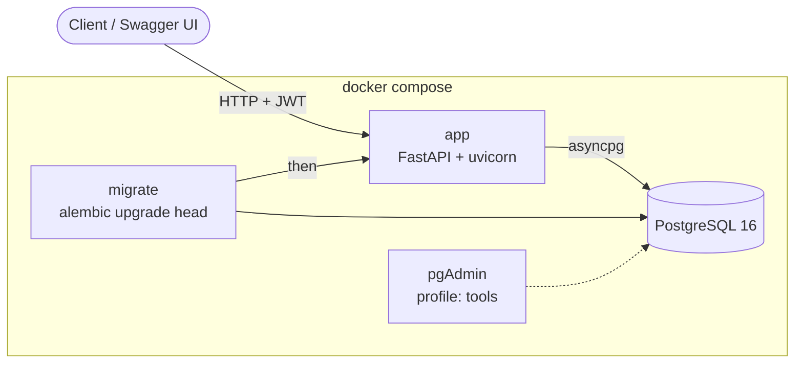

# Network Asset & Incident Management API

[](https://github.com/Gael-Majestic/network_asset_management/actions/workflows/ci.yml)

A REST API for IT teams to track infrastructure assets (routers, switches, servers, firewalls,
access points, virtual machines) and the network incidents that affect them. Built with FastAPI,
async SQLAlchemy and PostgreSQL, with Alembic migrations, JWT authentication with user and admin
roles, Docker Compose for local runs, and Terraform for an AWS development VM.

The code is commented as a learning resource: look for the `CONCEPT —` notes in each file.

---

## Tech stack

| Layer | Technology |
|---|---|
| Framework | FastAPI, Pydantic v2 |
| Database | PostgreSQL 16, SQLAlchemy 2 (async, asyncpg driver) |
| Migrations | Alembic (async `env.py`, checked against PostgreSQL in CI) |
| Authentication | OAuth2 password flow, JWT (PyJWT), Argon2 password hashing (pwdlib) |
| Containers | Multi-stage Dockerfile, non-root user, health check; Docker Compose |
| Infrastructure | Terraform: AWS EC2 development VM |
| Quality | pytest + pytest-asyncio (50 tests, ~93% coverage), Ruff, GitHub Actions, Dependabot |

## How it fits together



`migrate` is a one-shot container built from the same image: it applies pending migrations and
exits, and `app` starts only after it succeeds. Two app replicas therefore never race to migrate
the same database, and a broken migration stops the deployment instead of the app.

## Features

- Registration, login (OAuth2 password form) and `GET /auth/me`; tokens expire after 30 minutes
- Two roles: any user can create assets and incidents and edit their own assets; admins can edit
  any asset and delete assets and incidents
- Assets record the tenant (company or site) they belong to; lists filter by tenant, type and status
- Incidents link to an asset (optional), and `resolved_at` is set by the server when an incident is
  resolved, kept when it is closed, and cleared when it is reopened
- Deleting an asset keeps the incident history: the incident's `asset_id` becomes `null`
- Input validation: IPv4/IPv6 addresses are checked and stored in canonical form, and a PATCH
  cannot set a required field to `null`
- Pagination with a stable order (`skip` / `limit`)
- Liveness (`/health`) and readiness (`/health/ready`, checks the database) endpoints
- Interactive documentation at `/docs`

---

## Quick start (Docker)

Requires Docker with the Compose plugin.

```bash
git clone https://github.com/Gael-Majestic/network_asset_management.git
cd network_asset_management
cp .env.example .env
```

Edit `.env`: choose a `POSTGRES_PASSWORD` and generate a `SECRET_KEY`:

```bash
python -c "import secrets; print(secrets.token_hex(32))"
```

Start the stack:

```bash
docker compose up -d --build
curl http://localhost:8000/health/ready
# {"status":"ready","database":"ok"}
```

Open **http://localhost:8000/docs**, register a user with `POST /auth/register`, click
**Authorize**, and log in with your email (as the username) and password.

Optional pgAdmin (on this machine only): set `PGADMIN_EMAIL` and `PGADMIN_PASSWORD` in `.env`, then
`docker compose --profile tools up -d` and browse to http://localhost:5050.

### Making an admin

There is deliberately no API endpoint that grants admin rights. An operator promotes a user in the
database:

```bash
docker compose exec db psql -U postgres -d network_asset_db \
  -c "UPDATE users SET is_admin = true WHERE email = 'you@example.com';"
```

## Development without Docker

Requires Python 3.12.

```bash
python -m venv .venv
source .venv/bin/activate          # Windows: .venv\Scripts\activate
pip install -r requirements-dev.txt

pytest                             # 50 tests on in-memory SQLite; no PostgreSQL needed
pytest --cov                       # with coverage
ruff check . && ruff format --check .
```

To run the API against the Compose database (`POSTGRES_HOST=localhost` in `.env`):

```bash
docker compose up -d db
alembic upgrade head
uvicorn app.main:app --reload
```

`docker compose watch` is the alternative inside Docker: it rebuilds and restarts the app container
whenever a file under `app/` changes.

### Changing the database schema

1. Edit a model in `app/models/`.
2. Generate a migration: `alembic revision --autogenerate -m "add serial number to assets"`.
3. Read the generated file in `alembic/versions/` and adjust it if needed.
4. Apply it: `alembic upgrade head`.

CI runs `alembic check`, which fails if a model change was committed without its migration.

---

## API overview

| Method | Endpoint | Who | Description |
|---|---|---|---|
| POST | `/auth/register` | anyone | Create an account |
| POST | `/auth/login` | anyone | Log in (form data), receive a JWT |
| GET | `/auth/me` | user | The logged-in account |
| GET | `/assets/` | user | List assets (`tenant`, `asset_type`, `status`, `skip`, `limit`) |
| GET | `/assets/{id}` | user | One asset |
| POST | `/assets/` | user | Create an asset (you become its owner) |
| PATCH | `/assets/{id}` | owner or admin | Update an asset |
| DELETE | `/assets/{id}` | admin | Delete an asset |
| GET | `/incidents/` | user | List incidents (`status`, `severity`, `asset_id`, `skip`, `limit`) |
| GET | `/incidents/{id}` | user | One incident |
| POST | `/incidents/` | user | Open an incident (you are the reporter) |
| PATCH | `/incidents/{id}` | user | Update status, severity, notes |
| DELETE | `/incidents/{id}` | admin | Delete an incident |
| GET | `/health` | anyone | Liveness |
| GET | `/health/ready` | anyone | Readiness (database reachable) |

## Continuous integration

[`.github/workflows/ci.yml`](.github/workflows/ci.yml) runs four jobs on every push and pull request:

| Job | What it proves |
|---|---|
| Lint and test | Ruff lint and format; the test suite passes with at least 85% coverage |
| Migrations on PostgreSQL | `alembic upgrade head` on a real PostgreSQL 16, `alembic check`, then downgrade to empty and upgrade again |
| Image and Compose smoke test | `docker build --check`; the Compose stack starts; register, log in, create an asset and an incident through the API; the container reports healthy |
| Terraform | `terraform fmt -check` and `terraform validate` |

All actions are pinned to commit SHAs, and Dependabot proposes updates for Python packages,
actions, base images and the Terraform provider.

---

## Project structure

```
network_asset_management/
├── app/                    # The Python package
│   ├── core/               # Settings (config.py), JWT and password hashing (security.py)
│   ├── db/                 # Async engine, session and the get_db dependency
│   ├── models/             # SQLAlchemy tables: User, Asset, Incident
│   ├── schemas/            # Pydantic request/response models and shared validators
│   ├── routers/            # Endpoints: auth, assets, incidents
│   ├── dependencies.py     # get_current_user, get_current_admin_user
│   └── main.py             # App, middleware, routers, health endpoints
├── alembic/                # Migrations (env.py, versions/)
├── tests/                  # pytest suite
├── infrastructure/         # Terraform for an AWS development VM, and SETUP_GUIDE.sh
├── .github/                # CI workflow and Dependabot
├── Dockerfile
├── compose.yaml
├── alembic.ini
├── pyproject.toml          # pytest, coverage and Ruff settings
├── requirements.txt        # Runtime dependencies (pinned)
└── requirements-dev.txt    # + test and lint tools
```

## Environment variables

| Variable | Required | Default | Description |
|---|---|---|---|
| `POSTGRES_USER` | Yes | — | PostgreSQL user |
| `POSTGRES_PASSWORD` | Yes | — | PostgreSQL password (any characters are safe) |
| `POSTGRES_DB` | Yes | — | Database name |
| `POSTGRES_HOST` | No | `db` | Database host (`localhost` when running uvicorn on your machine) |
| `POSTGRES_PORT` | No | `5432` | Database port |
| `SECRET_KEY` | Yes | — | JWT signing key; generate a random 32-byte hex string |
| `ACCESS_TOKEN_EXPIRE_MINUTES` | No | `30` | Token lifetime |
| `CORS_ORIGINS` | No | `[]` | Browser origins allowed to call the API, as a JSON list |
| `DEBUG` | No | `false` | Log every SQL statement |
| `PGADMIN_EMAIL`, `PGADMIN_PASSWORD` | For pgAdmin | — | pgAdmin login (`--profile tools` only) |

## Infrastructure

[`infrastructure/`](infrastructure/) describes a development VM on AWS (EC2 with Docker, an XFCE
desktop over RDP and an Elastic IP). SSH, RDP and the API port are open only to the address in
`admin_cidr`; pgAdmin is reached through an SSH tunnel. [`SETUP_GUIDE.sh`](infrastructure/SETUP_GUIDE.sh)
walks through creating, using and destroying it. The VM is not running; the code is kept as a
reference.

## Status

A personal learning project, maintained. Ideas for next steps: refresh tokens, an audit log of
incident status changes, and enforced per-tenant access.

Parts of the 2026 revision (project layout, migrations, CI, tests) were made with the help of
Claude, an AI assistant, and reviewed by me.
